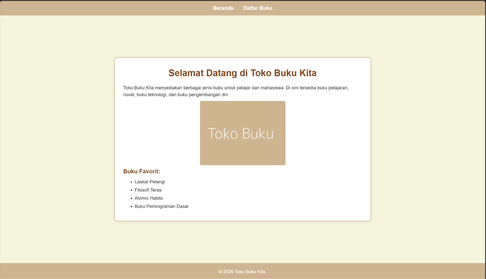
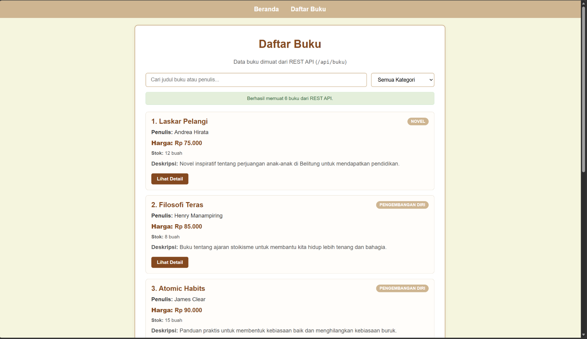

# Tugas Pemrograman Web (Semester 5)
## Proyek: Website Toko Buku Kita (Arsitektur REST API Native)

## 📌 Penjelasan Teknologi & Konsep yang Digunakan

Berikut adalah rincian teknologi dan konsep yang diterapkan:

### 1. Frontend (Sisi Klien)

* **HTML5 (Hypertext Markup Language 5)**:
  * Menggunakan elemen semantik standar (`<header>`, `<nav>`, `<article>`, `<section>`, `<footer>`) untuk menyusun struktur halaman yang baik, terstandarisasi W3C, dan ramah aksesibilitas (*accessibility*).

* **CSS3 (Cascading Style Sheets 3)**:
  * **Flexbox Layout**: Mengatur tata letak halaman secara fleksibel.
  * **Centered Card Layout**: Kotak konten utama (`.konten`) diposisikan presisi di tengah layar (vertikal dan horizontal) menggunakan `margin: auto` pada container flex.
  * **Sticky Footer**: Bagian *footer* (`<footer>`) selalu berada di bagian paling bawah layar (*viewport*) meskipun konten halaman sedang sedikit.
  * **Responsive Web Design**: Menggunakan *Media Queries* (`@media (max-width: 600px)`) agar ukuran elemen, form filter, dan kartu buku menyesuaikan diri secara otomatis pada perangkat desktop, tablet, maupun layar ponsel pintar (*mobile*).

* **Vanilla JavaScript (ES6+)**:
  * **Asynchronous Programming (`async/await` & `fetch`)**: Mengambil data buku dari REST API secara *asynchronous* tanpa perlu memuat ulang (*reload*) seluruh halaman (konsep dasar *Single-Page Application / AJAX*).
  * **DOM Manipulation Dinamis**: Merender data JSON yang diterima dari server menjadi elemen-elemen kartu buku HTML secara terprogram (`createElement`, `append`, `replaceChildren`).
  * **Fitur Filter & Live Search**: Menyaring data buku berdasarkan kata kunci judul/penulis serta filter kategori secara *real-time* di sisi klien (*client-side filtering*).
  * **Format Mata Uang Rupiah**: Menggunakan API internasionalisasi bawaan browser (`Intl.NumberFormat('id-ID')`) untuk memformat angka harga ke format mata uang Rupiah secara rapi dan standar.

---

### 2. Backend (Sisi Server)

* **Node.js Runtime (v18+)**:
  * Menjalankan server lokal dan memproses logika bisnis tanpa memerlukan server eksternal seperti Apache atau Nginx.

* **Modul Bawaan (Native Modules - Zero Dependencies)**:
  * **`node:http`**:
    * Membangun HTTP Web Server dari dasar (*scratch*).
    * Mengelola siklus *Request* dan *Response* (membaca *headers*, menangani metode HTTP, dan menulis respon).
    * Mengimplementasikan *router* untuk menyajikan berkas statis (HTML, CSS, JS, JPG) serta routing untuk REST API (`/api/buku`).
  * **`node:fs`**:
    * Menangani operasi baca-tulis berkas basis data (`buku.json`).
    * **Atomic File Write**: Menggunakan mekanisme penulisan ke berkas sementara (`.tmp`) sebelum menggantikan berkas utama guna menjamin integritas data agar tidak rusak (*corrupt*) jika server berhenti tiba-tiba saat proses penyimpanan.
  * **`node:path`**:
    * Menstandarisasi jalur berkas sistem dan mencegah celah keamanan *Path Traversal*.

---

### 3. Database / Penyimpanan Data

* **JSON Flat-File Database (`buku.json`)**:
  * Menggunakan berkas JSON terstruktur untuk menyimpan entitas buku (ID, judul, penulis, harga, kategori, deskripsi, dan stok).
  * Format JSON dipilih sebagai standar baku pertukaran data yang ringan dan terintegrasi secara alami dengan JavaScript.

---

### 4. Arsitektur REST API & Protokol HTTP

Sistem menerapkan kaidah arsitektur **REST (Representational State Transfer)**:
* Pemisahan tugas yang jelas antara *Client* (penyaji antarmuka) dan *Server* (penyedia data dan logika).
* Menggunakan metode HTTP standar sesuai fungsinya:
  * **`GET /api/buku`**: Mengambil daftar seluruh buku (mendukung *query filtering*).
  * **`GET /api/buku/:id`**: Mengambil rincian spesifik satu buku berdasarkan ID.
  * **`POST /api/buku`**: Menambahkan data buku baru ke database.
  * **`PUT /api/buku/:id`**: Memperbarui informasi buku yang sudah ada.
  * **`DELETE /api/buku/:id`**: Menghapus data buku dari database.
* Menggunakan *HTTP Status Codes* yang sesuai standar industri:
  * `200 OK` (Permintaan berhasil)
  * `201 Created` (Data baru berhasil disimpan)
  * `400 Bad Request` (Validasi input data gagal)
  * `404 Not Found` (Buku / rute tidak ditemukan)
  * `500 Internal Server Error` (Kesalahan internal server)

## 📸 Dokumentasi & Tangkapan Layar (Screenshots)

### 1. Tampilan Halaman Beranda (Home)

---

### 2. Tampilan Halaman Katalog Daftar Buku (Data dari REST API)

---
